# PawLog

Windows의 활성 창을 기준으로 프로그램 사용 시간을 기록하고 통계를 보여주는 Java 애플리케이션입니다.

## 개발 환경

- Windows
- JDK 24
- Java Swing/AWT
- JNA (`lib` 폴더)
- H2 Database (`lib` 폴더)

## VS Code에서 실행

1. Extension Pack for Java 확장을 설치합니다.
2. `src/ui.Widget.java` 또는 `src/Main.java`를 엽니다.
3. `main` 메서드 위의 **Run**을 누릅니다.

Windows API를 사용하는 `Main` 실행 시 JVM 옵션으로 아래 값을 사용합니다.

```text
--enable-native-access=ALL-UNNAMED
```

## DB 스키마

```mermaid
erDiagram
    users {
        BIGINT user_id PK "사용자 고유 번호"
        VARCHAR email UK "로그인용 이메일 계정"
        VARCHAR password_hash "암호화된 비밀번호"
        VARCHAR nickname "닉네임"
        ENUM gender "성별 (M, F)"
        DATE birth_date "생년월일"
        DATETIME created_at "계정 가입 일시"
    }

    categories {
        INT category_id PK "카테고리 고유 번호"
        VARCHAR name UK "카테고리명"
    }

    programs {
        BIGINT program_id PK "프로그램 고유 번호"
        VARCHAR process_name UK "프로세스 실행 파일명"
        VARCHAR display_name "화면 표시용 프로그램 이름"
        INT category_id FK "카테고리 고유 번호"
    }

    programs_likes {
        BIGINT program_id PK, FK "좋아요 눌린 프로그램 번호"
        BIGINT user_id PK, FK "좋아요 누른 사용자 번호"
    }

    usage_logs {
        BIGINT log_id PK "사용 기록 고유 번호"
        BIGINT user_id FK "사용자 고유 번호"
        BIGINT program_id FK "프로그램 고유 번호"
        BOOLEAN is_foreground "포어그라운드 실행 여부"
        DATETIME start_time "사용 시작 일시"
        DATETIME end_time "사용 종료 일시"
        INT duration_sec "총 사용 시간(초)"
    }

    daily_usage_summary {
        BIGINT summary_id PK "요약 데이터 고유 번호"
        BIGINT user_id FK "사용자 고유 번호"
        BIGINT program_id FK "프로그램 고유 번호"
        DATE summary_date "집계 대상 날짜"
        BIGINT foreground_duration_sec "하루 포어그라운드 사용시간"
        BIGINT background_duration_sec "하루 백그라운드 사용시간"
        BIGINT total_duration_sec "하루 동안의 총 사용 시간(초)"
    }

    program_rankings {
        BIGINT ranking_id PK "순위 기록 고유 번호"
        BIGINT program_id FK "프로그램 고유 번호"
        ENUM period_type "집계 기간 단위 (DAILY, WEEKLY, MONTHLY)"
        DATE ranking_date "순위 집계 기준 날짜"
        INT rank_position "집계된 순위"
        BIGINT total_duration_sec "총 사용 시간"
        ENUM gender "조건 분류 성별 (M, F)"
        VARCHAR age_group "조건 분류 연령대"
    }

    program_usage_stats {
        BIGINT stat_id PK "통계 데이터 고유 번호"
        BIGINT program_id FK "프로그램 고유 번호"
        ENUM period_type "집계 기간 단위 (DAILY, WEEKLY, MONTHLY)"
        DATE stat_date "통계 기준 날짜"
        FLOAT avg_foreground_sec "평균 포어그라운드 사용 시간"
        FLOAT avg_background_sec "평균 백그라운드 사용 시간"
        FLOAT avg_duration_sec "하루 평균 총 사용 시간"
        INT total_users "이용한 유저 수"
        ENUM gender "조건 분류 성별 (M, F)"
        VARCHAR age_group "조건 분류 연령대"
    }

    posts {
        BIGINT post_id PK "게시글 고유 번호"
        BIGINT user_id FK "작성자 고유 번호"
        BIGINT program_id FK "커뮤니티 태그용 프로그램 번호"
        VARCHAR title "게시글 제목"
        TEXT content "게시글 본문 내용"
        DATETIME created_at "게시글 작성 일시"
    }

    comments {
        BIGINT comment_id PK "댓글 고유 번호"
        BIGINT post_id FK "대상 게시글 고유 번호"
        BIGINT user_id FK "작성자 고유 번호"
        TEXT content "댓글 내용"
        DATETIME created_at "댓글 작성 일시"
    }

    post_likes {
        BIGINT user_id PK, FK "좋아요 사용자 번호"
        BIGINT post_id PK, FK "대상 게시글 번호"
    }

    prediction_events {
        BIGINT event_id PK "예측 이벤트 고유 번호"
        VARCHAR title "이벤트 제목"
        DATETIME created_at "이벤트 생성 일시"
        DATETIME voting_deadline "예측 마감기한"
        ENUM status "이벤트 상태 (OPEN, CLOSED, ANNOUNCED)"
        DATE target_date "예측 대상 기간 날짜"
        ENUM event_type "이벤트 단위 (WEEKLY, MONTHLY)"
    }

    prediction_votes {
        BIGINT vote_id PK "투표 기록 고유 번호"
        BIGINT event_id FK "대상 예측 이벤트 번호"
        BIGINT user_id FK "투표한 사용자 번호"
        BIGINT program_id FK "투표 대상 프로그램 번호"
    }

    categories ||--o{ programs : "contains"
    users ||--o{ programs_likes : "likes"
    programs ||--o{ programs_likes : "liked_by"
    users ||--o{ usage_logs : "records"
    programs ||--o{ usage_logs : "logged_in"
    users ||--o{ daily_usage_summary : "has"
    programs ||--o{ daily_usage_summary : "summarized_in"
    programs ||--o{ program_rankings : "ranked_in"
    programs ||--o{ program_usage_stats : "analyzed_in"
    users ||--o{ posts : "writes"
    programs ||--o{ posts : "tagged_in"
    posts ||--o{ comments : "has"
    users ||--o{ comments : "writes"
    users ||--o{ post_likes : "likes"
    posts ||--o{ post_likes : "liked_by"
    prediction_events ||--o{ prediction_votes : "includes"
    users ||--o{ prediction_votes : "votes"
    programs ||--o{ prediction_votes : "voted_for"
```
